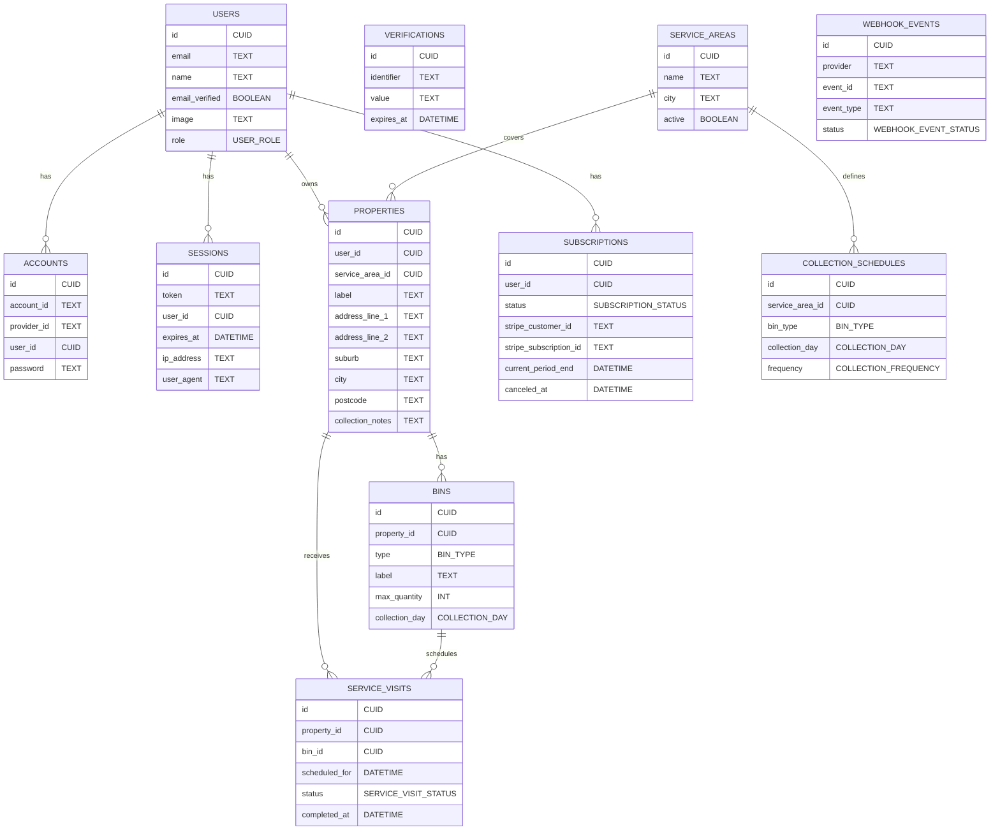

# Data Model

`BIN_TYPE` values are `RECYCLING_BINS`, `RUBBISH_BAGS`, `RUBBISH_WHEELIE`, and
`GREEN_WASTE_WHEELIE`. Red and blue recycling bins are modeled as one service
item because they go out together. Prepaid rubbish bags can store a per-service
maximum quantity; the current local seed cap is three bags.

